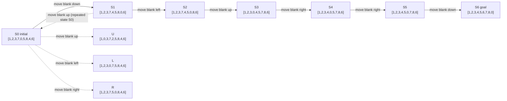

# 8-Puzzle Diagram

Matches `outputs/eight_puzzle.json`. States are flat lists, `0` = blank. Initial = S0, goal = S6. The solid path S0→S6 is an optimal 6-move path. Dashed nodes are other legal moves from S0. The edge S1→S0 shows a repeated state, which BFS skips.

