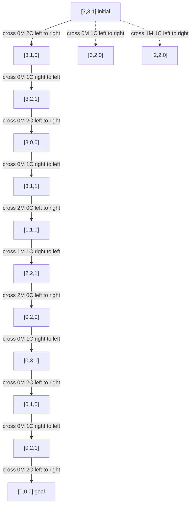

# Missionaries and Cannibals Diagram

Matches `outputs/missionaries_cannibals.json`. State = `[missionaries_left, cannibals_left, boat_left]` (boat 1 = left bank). Initial `[3,3,1]`, goal `[0,0,0]`, boat capacity 2. The main path has 11 crossings. Dashed nodes are the other two legal first moves (the remaining first moves, 1M or 2M alone, leave an unsafe bank).

