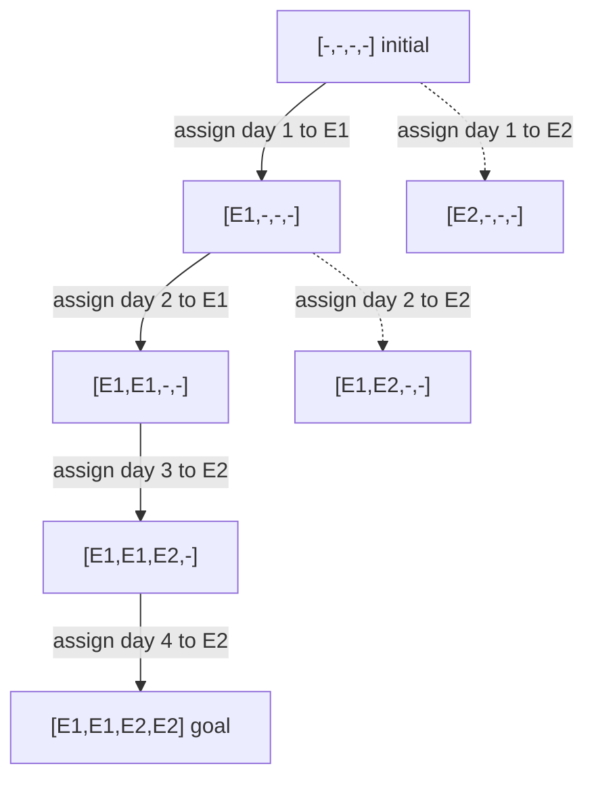

# Rotating Workforce Diagram (toy model)

Matches `outputs/rotating_workforce.json`. **All constraints are student-invented** (2 employees, 4 days, at most 2 days per employee, at most 2 consecutive days) and are not official requirements. Each entry is the employee for days 1–4, `-` = unassigned. From `[E1,E1,-,-]` assigning E1 to day 3 is not an edge because it would give E1 three days. Real workforce scheduling needs the instructor's or problem owner's actual constraints.

